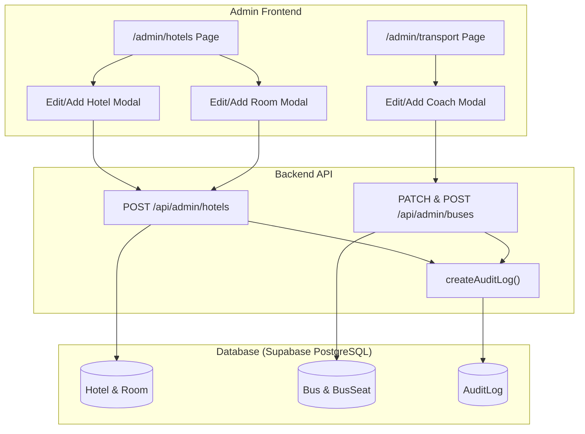

# Editable Hotels & Transport Management Implementation Plan

> **For agentic workers:** REQUIRED SUB-SKILL: Use superpowers:subagent-driven-development (recommended) or superpowers:executing-plans to implement this plan task-by-task. Steps use checkbox (`- [ ]`) syntax for tracking.

**Goal:** Enable trip coordinators to edit, add, update, and manage hotel properties, rooms, coaches, and mountain chauffeur crew in real-time from `/admin/hotels` and `/admin/transport`.

**Architecture:** Extend `POST /api/admin/hotels` with `UPDATE_HOTEL`, `DELETE_HOTEL`, `UPDATE_ROOM`, and `DELETE_ROOM` actions backed by Prisma `Hotel` and `Room` models. Connect `/admin/transport` to the existing `PATCH /api/admin/buses` and `POST /api/admin/buses` endpoints. Implement modern, responsive Alpine-styled dialog modals for seamless in-place editing with instantaneous database synchronization and immutable audit logging.

**Architecture Diagram:**

**Tech Stack:** Next.js 16 (App Router), React 19, TypeScript, Prisma 6, Tailwind CSS v4, Lucide React icons.

**Spec:** Brainstorming discussion and interactive concept mockup in `hotel-transport-preview.html`.

---

## Global Constraints

- Preserve all existing room assignment and passenger allocation logic (`RoomAssignment` and `BusSeat`).
- All admin mutations must require authenticated admin session via `getCurrentAdmin()`.
- Every mutation must record an entry in `AuditLog`.
- Zero raw unlayered CSS that overrides dark theme typography; maintain high-contrast text on dark backgrounds (`#101916`).

---

## Review Focus

1. Editing a hotel name or address must not disrupt existing room assignments for confirmed travellers.
2. Changing room bed capacity must validate that current occupied beds do not exceed the new capacity.
3. Updating coach vehicle details or chauffeur contacts must preserve existing seat bookings and bus seat layouts.
4. Input fields must trim whitespace and sanitize strings before database storage.
5. Modal state must reset cleanly on cancellation or successful save without stale dirty data.

---

## Tasks

### Task 1: Extend Hotel Management Backend API (`/api/admin/hotels`)

- [ ] Add `UPDATE_HOTEL` action handling `hotelId`, `name`, `location`, `address`, `contactPerson`, `contactPhone`, `checkInDate`, `checkOutDate`.
- [ ] Add `DELETE_HOTEL` action with verification and cascade safety.
- [ ] Add `UPDATE_ROOM` action handling `roomId`, `roomNumber`, `roomType`, `capacity`, and `notes`.
- [ ] Add `DELETE_ROOM` action ensuring rooms with active assignments are protected or unassigned safely.
- [ ] Verify with automated test script `src/server/test-hotel-transport-editing.js`.
- [ ] Commit changes.

### Task 2: Build Editable Hotels & Rooms Frontend (`/admin/hotels`)

- [ ] Add "Edit Hotel" button and modal to each property card with inputs for name, location, address, contact person, phone.
- [ ] Add "+ Add Hotel" header button and creation modal.
- [ ] Add "+ Add Room" button and modal on each property card (room number, room type, capacity).
- [ ] Add "Edit Room" quick action on each room card.
- [ ] Enhance contrast and typography matching Alpine dark theme.
- [ ] Verify modal interactions, save states, and error handling.
- [ ] Commit changes.

### Task 3: Build Editable Transport Fleet & Chauffeur Frontend (`/admin/transport`)

- [ ] Add "Edit Coach" button to each coach card in `src/app/admin/transport/page.tsx`.
- [ ] Build "Edit Coach & Crew" modal pre-filled with `busNumber`, `vehicleName`, `vehicleNumber`, `driverName`, `driverPhone`, `conductorName`, `conductorPhone`, and `status`.
- [ ] Add "+ Add Coach" button in header to provision new vehicles using `POST /api/admin/buses`.
- [ ] Wire save handler to `PATCH /api/admin/buses` with optimistic feedback and live state reload.
- [ ] Polish typography and dark theme contrast.
- [ ] Commit changes.

### Task 4: End-to-End Verification & Localhost Testing

- [ ] Run full automated verification suite `node src/server/test-hotel-transport-editing.js`.
- [ ] Run TypeScript typecheck `npm.cmd run typecheck`.
- [ ] Verify on live Next.js dev server (`http://localhost:3000/admin/hotels` and `http://localhost:3000/admin/transport`).
- [ ] Capture verification screenshots and confirm visual polish.
