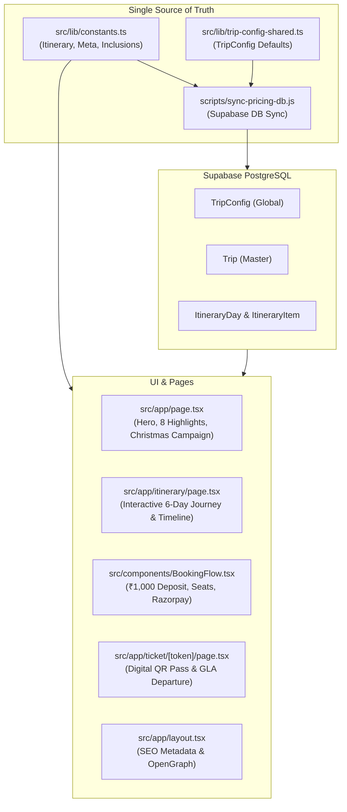

# Himalayan Escape – Christmas Special 2026 Redesign & Itinerary Update Implementation Plan

> **For agentic workers:** REQUIRED SUB-SKILL: Use superpowers:subagent-driven-development (recommended) or superpowers:executing-plans to implement this plan task-by-task. Steps use checkbox (`- [ ]`) syntax for tracking.

**Goal:** Transform the Himalayan Escape website into the official "Himalayan Escape – Christmas Special 2026" 6 Days / 5 Nights edition with updated route (GLA University Mathura → Kasol camping → Manikaran → Manali hotel → Solang & Sissu → Jogini Waterfall & Christmas celebrations → GLA University), editorial mountain & festive aesthetic, transparent ₹6,200 rate with ₹1,000 deposit, and responsive mobile-first booking experience.

**Architecture:** Centralize all trip definitions, itinerary, pricing, pickup/drop timings, and contact numbers in `src/lib/constants.ts` and `src/lib/trip-config-shared.ts` (the SSOT). Synchronize the Supabase PostgreSQL database tables (`tripConfig`, `trip`, `itineraryDay`, `itineraryItem`, `settings`) so both server-side dynamic fetches and client-side static fallbacks are identical. Update the public presentation layer (`src/app/page.tsx`, `src/app/itinerary/page.tsx`, `src/components/BookingFlow.tsx`, `src/app/ticket/[token]/page.tsx`, `src/app/layout.tsx`) using the established palette (`#163C32`, `#F7F5EF`, `#D87945`, `#17211D`, `#FFFFFF`), preserving all existing seat holding, Razorpay integration, and authentication workflows.

**Architecture Diagram:**



**Tech Stack:** Next.js 15 (App Router, Turbopack, React Server Components), TypeScript, Tailwind CSS, Lucide React, Prisma ORM, Supabase PostgreSQL, Razorpay Checkout SDK.

**Spec:** User Master Prompt: "MASTER WEBSITE REDESIGN & ITINERARY UPDATE PROMPT - Himalayan Escape – Christmas Special 2026"

## Global Constraints

- **Trip Name:** `Himalayan Escape – Christmas Special 2026`
- **Duration:** `6 Days / 5 Nights`
- **Departure Location:** `GLA University, Mathura`
- **Departure Time:** `12:00 PM` (assemble & board AC Traveller)
- **Return Departure:** `Manali at 4:00 PM on Day 5`
- **Destinations:** `Kasol, Manikaran, Manali, Solang Valley, Sissu, Jogini Waterfall`
- **Transport:** `AC Traveller Bus`
- **Pricing:** `₹6,200 per traveller` total; `₹1,000 reservation deposit`; `₹5,200 remaining balance` before boarding at GLA University.
- **Contact Details (Strict):** Lead Student Organizer Saurabh Pandey (`8126854850`), Helpline (`6398412828`). Never invent numbers.
- **Payment & Booking:** Never charge full price when reservation deposit is selected; preserve Razorpay checkout, live seat hold timers, and QR ticket verification.

## Review Focus

1. **Itinerary Sequence Correctness:** Day 1 (GLA Mathura departure at 12 PM) → Day 2 (Kasol riverside camping, Manikaran, bonfire/DJ) → Day 3 (Manali check-in at riverside hotel with 3 gardens, Hadimba, Mall Road, Old Manali) → Day 4 (Solang Valley, Sissu via Atal Tunnel, bonfire) → Day 5 (Jogini Waterfall, Christmas celebrations at Mall Road, 4 PM return departure) → Day 6 (Arrival at GLA University).
2. **Timing & Balance Clarity:** Explicit notice that balance ₹5,200 is due before boarding at GLA University, Mathura.
3. **Food Policy Consistency:** Dinner included on Day 2; Breakfast & Dinner on Day 3; Breakfast & Dinner on Day 4; Breakfast on Day 5. No food during travel/transit time (Day 1 departure & Day 5 return journey).
4. **Activity Cost Demarcation:** Solang paragliding, skiing, ATV rides marked as self-paid optional. Rohtang Pass framed strictly as alternative subject to permits/weather.
5. **Mobile Responsiveness:** Sticky CTAs, touch-friendly expandable itinerary cards, seat selection map, and WhatsApp buttons on small screens without horizontal scroll.

---

### Task 1: Update Central Trip Configuration & Constants (SSOT)

**Files:**
- Modify: [src/lib/constants.ts](file:///c:/Users/hp/OneDrive/Desktop/antigravity%20workspace/trip/src/lib/constants.ts:1-260)
- Modify: [src/lib/trip-config-shared.ts](file:///c:/Users/hp/OneDrive/Desktop/antigravity%20workspace/trip/src/lib/trip-config-shared.ts:1-45)
- Modify: [scripts/sync-pricing-db.js](file:///c:/Users/hp/OneDrive/Desktop/antigravity%20workspace/trip/scripts/sync-pricing-db.js:1-90)

**Interfaces:**
- Produces: Updated `TRIP_METADATA`, `ITINERARY_DAYS`, `INCLUSIONS_LIST`, `EXCLUSIONS_LIST`, `DEFAULT_TRIP_CONFIG`.
- Consumes: Prisma database client for syncing `tripConfig`, `trip`, `settings`, `itineraryDay`, and `itineraryItem`.

- [ ] **Step 1: Update metadata, pricing, and 6-day itinerary in `src/lib/constants.ts`**
  - Set `TRIP_METADATA.name` to `'Himalayan Escape – Christmas Special 2026'`.
  - Set `TRIP_METADATA.origin` and `reportingLocation` to `'GLA University, Mathura (Departure: 12:00 PM)'`.
  - Set `TRIP_METADATA.destination` to `'Kasol, Manikaran, Manali, Solang Valley, Sissu & Jogini Waterfall'`.
  - Replace `ITINERARY_DAYS` with the complete official 6-day itinerary:
    - Day 1: Mathura to Himachal | Departure 12:00 PM (GLA University assembly, AC Traveller, overnight journey).
    - Day 2: Kasol Riverside Camping (arrival, riverside campsite, Manikaran Sahib & Kasol Market, local cafés, evening bonfire & DJ night, dinner included).
    - Day 3: Manali Local Exploration (Kasol to Manali, check-in riverside hotel with 3 gardens, Hadimba Temple, Mall Road, Old Manali Café Street, Vashisht Temple, Van Vihar, dinner included).
    - Day 4: Solang Valley & Sissu Adventure (Solang Valley adventures - paragliding/skiing/ATV self-paid, Atal Tunnel, Sissu waterfall & landscapes, evening bonfire & music, dinner included; Rohtang Pass noted as alternative if open).
    - Day 5: Jogini Waterfall & Christmas Celebration (riverside breakfast, Jogini Waterfall, Christmas decorations at Mall Road, shopping/cafés, 4:00 PM return departure, overnight journey).
    - Day 6: Arrival at Mathura (early arrival at GLA University campus).
  - Update `INCLUSIONS_LIST` & `EXCLUSIONS_LIST` to reflect 1 Night Kasol riverside camps + 2 Nights Manali hotel (3 gardens) + 3 Dinners + 3 Breakfasts.

- [ ] **Step 2: Update `src/lib/trip-config-shared.ts`**
  - Set `tripTitle: 'Himalayan Escape – Christmas Special 2026'`.
  - Set `subtitle: '6 Days. 5 Nights. Endless Memories. Celebrate Christmas in the Himalayas.'`.
  - Set `pickupLocation: 'GLA University, Mathura'`.
  - Set `reportingTime: '12:00 PM'`.
  - Set `departureDate: '2026-12-24'`, `returnDate: '2026-12-29'`.

- [ ] **Step 3: Update `scripts/sync-pricing-db.js` and sync to Supabase DB**
  - Add logic to upsert the updated itinerary days and items directly into the Supabase `itineraryDay` and `itineraryItem` tables so `/api/itinerary` returns the exact 6-day sequence.
  - Run: `node scripts/sync-pricing-db.js`
  - Expected: Database updated with 0 errors.

- [ ] **Step 4: Verify with typecheck and API test**
  - Run: `npm.cmd run typecheck`
  - Verify `/api/itinerary` returns the 6 days starting with GLA University Mathura and ending with Day 6.

- [ ] **Step 5: Commit**
  ```bash
  git add src/lib/constants.ts src/lib/trip-config-shared.ts scripts/sync-pricing-db.js
  git commit -m "feat: update SSOT trip config, metadata, and 6-day Christmas itinerary"
  ```

---

### Task 2: Build the Premium Interactive 6-Day Itinerary Page

**Files:**
- Modify: [src/app/itinerary/page.tsx](file:///c:/Users/hp/OneDrive/Desktop/antigravity%20workspace/trip/src/app/itinerary/page.tsx:1-180)

**Interfaces:**
- Consumes: `ITINERARY_DAYS`, `TRIP_METADATA`, `INCLUSIONS_LIST`, `EXCLUSIONS_LIST`, `PACKING_LIST` from `src/lib/constants.ts`.
- Produces: Interactive vertical journey layout with expandable day cards, day badges, photography, accommodation highlights, meal tags, departure clocks, and journey route visualization.

- [ ] **Step 1: Implement vertical timeline and interactive day cards**
  - Modern vertical journey stepper with connecting trail line.
  - Distinct cards for each of the 6 days:
    - Day 1: "THE JOURNEY BEGINS" • GLA University Departure (12:00 PM)
    - Day 2: "KASOL RIVERSIDE CAMPING" • Manikaran Sahib & DJ Bonfire Night
    - Day 3: "MANALI LOCAL EXPLORATION" • 3-Garden Riverside Hotel & Old Manali Cafés
    - Day 4: "SOLANG VALLEY & SISSU ADVENTURE" • Atal Tunnel & Snow Foothills
    - Day 5: "JOGINI WATERFALL & CHRISTMAS CELEBRATION" • Mall Road Festivities & 4:00 PM Return Departure
    - Day 6: "ARRIVAL AT MATHURA" • Safe Drop at GLA University Campus
  - Include tags: Meal inclusions (Breakfast/Dinner/Self-paid), accommodation details (Campsite/Hotel/Coach), and extra-cost badges for adventure activities.
  - Add visual destination journey map / schematic route indicator (GLA University → Kasol → Manikaran → Manali → Solang → Sissu → Jogini → GLA University).

- [ ] **Step 2: Add high-quality visuals & responsive accordion controls**
  - Ensure every day has an accompanying curated photograph (Kasol riverside, Manikaran, Old Manali, Solang Valley, Atal Tunnel/Sissu, Jogini Waterfall, Christmas lights).
  - Add quick action buttons: "Book Your Adventure", "Download Packing Guide", and "Ask Coordinator on WhatsApp".

- [ ] **Step 3: Verify page builds cleanly**
  - Run: `npm.cmd run typecheck`

- [ ] **Step 4: Commit**
  ```bash
  git add src/app/itinerary/page.tsx
  git commit -m "feat: redesign 6-day interactive itinerary page with Christmas journey"
  ```

---

### Task 3: Redesign Homepage (Hero, Highlights Cards, Christmas Campaign, & Body Layout)

**Files:**
- Modify: [src/app/page.tsx](file:///c:/Users/hp/OneDrive/Desktop/antigravity%20workspace/trip/src/app/page.tsx:1-700)
- Modify: [src/components/DestinationCarousel.tsx](file:///c:/Users/hp/OneDrive/Desktop/antigravity%20workspace/trip/src/components/DestinationCarousel.tsx:1-80)

**Interfaces:**
- Consumes: `TRIP_METADATA`, `CONTACT_INFO`, `ITINERARY_DAYS`, `getSeatAvailability()`.
- Produces: Comprehensive Christmas campaign homepage with hero banner, 8 highlights cards, dedicated Christmas section, and mobile-optimized booking anchors.

- [ ] **Step 1: Redesign Hero Section**
  - Headline: `ESCAPE THE ORDINARY. EXPERIENCE THE HIMALAYAS.`
  - Subheadline: `6 Days. 5 Nights. Endless Memories.`
  - Supporting copy: `From riverside camping in Kasol to snow adventures in Manali, celebrate Christmas surrounded by the magic of the mountains.`
  - Key Pills & Stat Counters:
    - `Christmas Special 2026`
    - `6 Days / 5 Nights`
    - `₹6,200 per traveller` (₹1,000 reservation deposit)
    - `Departure: GLA University, Mathura (12:00 PM)`
    - `Seats Available` counter synced with DB
  - Three Primary CTAs:
    - `Explore Itinerary` (links to `#itinerary`)
    - `Book Your Adventure` (links to `/book`)
    - `Enquire on WhatsApp` (direct link to `wa.me/918126854850`)

- [ ] **Step 2: Implement the 8 Homepage Highlights Cards**
  - Create the 8 responsive destination cards with imagery and concise editorial copy:
    1. **Kasol Riverside Camping:** Pitching tents under tall pine trees by the roaring Parvati River with starlit night skies.
    2. **Manikaran Sahib:** Revered Sikh shrine with therapeutic hot sulphur springs and sacred Shiva temple.
    3. **Manali Local Sightseeing:** Hadimba Devi temple in Dhungri forest, Vashisht, Tibetan monastery, and Van Vihar.
    4. **Solang Valley Adventures:** High-altitude adventure bowl for paragliding, skiing, and ATV trails (self-paid).
    5. **Atal Tunnel & Sissu:** Cruising the 9.02 km engineering marvel to trans-Himalayan frozen landscapes and Sissu waterfall.
    6. **Jogini Waterfall:** Picturesque trek through apple orchards and pine woods to the cascading waterfall.
    7. **Christmas Celebration:** Magical Christmas tree lights, festive music, shopping, and celebrations along Manali Mall Road.
    8. **Bonfire & DJ Night:** Riverside campfire beats, music, group games, and warm community vibes.

- [ ] **Step 3: Implement the Dedicated Christmas Campaign Section**
  - Banner: `THIS CHRISTMAS, TRADE CITY LIGHTS FOR MOUNTAIN NIGHTS.`
  - Supporting text: `Celebrate the most magical time of the year with riverside camping, mountain adventures, festive vibes and unforgettable memories.`
  - Festive visual treatment: subtle snow effect, warm glow accents, mountain pine atmosphere.

- [ ] **Step 4: Update Itinerary Preview on Homepage**
  - Align homepage `#itinerary` section with the new 6-day flow (Kasol first, then Manali, Solang/Sissu, Jogini & return).

- [ ] **Step 5: Verify homepage rendering and typecheck**
  - Run: `npm.cmd run typecheck`

- [ ] **Step 6: Commit**
  ```bash
  git add src/app/page.tsx src/components/DestinationCarousel.tsx
  git commit -m "feat: redesign homepage hero, 8 highlights cards, and Christmas campaign section"
  ```

---

### Task 4: Align Booking Flow, Pricing Breakdown, Confirmation & Digital QR Ticket

**Files:**
- Modify: [src/components/BookingFlow.tsx](file:///c:/Users/hp/OneDrive/Desktop/antigravity%20workspace/trip/src/components/BookingFlow.tsx:1-400)
- Modify: [src/app/book/page.tsx](file:///c:/Users/hp/OneDrive/Desktop/antigravity%20workspace/trip/src/app/book/page.tsx:1-120)
- Modify: [src/app/ticket/[token]/page.tsx](file:///c:/Users/hp/OneDrive/Desktop/antigravity%20workspace/trip/src/app/ticket/[token]/page.tsx:1-400)
- Modify: [src/components/Footer.tsx](file:///c:/Users/hp/OneDrive/Desktop/antigravity%20workspace/trip/src/components/Footer.tsx:1-129)
- Modify: [src/app/terms/page.tsx](file:///c:/Users/hp/OneDrive/Desktop/antigravity%20workspace/trip/src/app/terms/page.tsx:1-180)

**Interfaces:**
- Consumes: Razorpay Checkout API, user passenger inputs, seat map hold API.
- Produces: Transparent deposit breakdown (₹1,000 advance per traveller; ₹5,200 balance due before boarding at GLA University), digital QR boarding passes, and receipts.

- [ ] **Step 1: Update BookingFlow summary and balance labels**
  - State clearly: Total ₹6,200 per traveller.
  - Payment breakdown: ₹1,000 reservation deposit due now; ₹5,200 remaining balance due before boarding at GLA University, Mathura.
  - Update route labels to: `GLA University, Mathura → Kasol → Manali → GLA University`.
  - Departure timing banner: `Departure: 12:00 PM from GLA University, Mathura`.

- [ ] **Step 2: Update Digital QR Ticket & Boarding Pass (`src/app/ticket/[token]/page.tsx`)**
  - Update boarding station to `GLA University, Mathura (Departure: 12:00 PM)`.
  - Update return departure notice: `Return Coach departs Manali at 4:00 PM on Day 5`.
  - Ensure QR code and luggage passes render the new trip title `Himalayan Escape – Christmas Special 2026`.

- [ ] **Step 3: Update Footer and Terms Page**
  - Synchronize [Footer.tsx](file:///c:/Users/hp/OneDrive/Desktop/antigravity%20workspace/trip/src/components/Footer.tsx) and [terms/page.tsx](file:///c:/Users/hp/OneDrive/Desktop/antigravity%20workspace/trip/src/app/terms/page.tsx) with GLA University Mathura reporting point, ₹6,200 package price, ₹1,000 deposit, and ₹5,200 balance.

- [ ] **Step 4: Verify typecheck**
  - Run: `npm.cmd run typecheck`

- [ ] **Step 5: Commit**
  ```bash
  git add src/components/BookingFlow.tsx src/app/book/page.tsx src/app/ticket/[token]/page.tsx src/components/Footer.tsx src/app/terms/page.tsx
  git commit -m "feat: update booking flow, tickets, terms, and receipts with GLA departure and Christmas details"
  ```

---

### Task 5: SEO Metadata, OpenGraph Tags, Global Content Sweep & Production Deployment

**Files:**
- Modify: [src/app/layout.tsx](file:///c:/Users/hp/OneDrive/Desktop/antigravity%20workspace/trip/src/app/layout.tsx:1-70)
- Modify: [src/app/privacy-policy/page.tsx](file:///c:/Users/hp/OneDrive/Desktop/antigravity%20workspace/trip/src/app/privacy-policy/page.tsx:1-100)

**Interfaces:**
- Produces: Valid Next.js Metadata object, OpenGraph tags, Twitter Cards, structured schema.

- [ ] **Step 1: Update SEO and Metadata in `src/app/layout.tsx`**
  - Title: `Himalayan Escape 2026 | 6 Days Manali & Kasol Christmas Trip from Mathura`
  - Description: `Experience a 6-day, 5-night Himalayan adventure from Mathura to Kasol and Manali. Enjoy riverside camping, Solang Valley, Sissu, Jogini Waterfall and Christmas celebrations.`
  - Keywords: `Himalayan Escape, Christmas Special 2026, GLA University Trip, Manali Kasol 6D5N, Solang Valley, Sissu, Jogini Waterfall, Riverside Camping Kasol, Student Mountain Expedition`.
  - OpenGraph & Twitter title, description, and images.

- [ ] **Step 2: Run a global sweep for old itinerary/timings**
  - Verify zero conflicting strings (e.g. old 5D/4N or outdated pickup times).
  - Verify all WhatsApp links point to `8126854850`.

- [ ] **Step 3: Final verification and build**
  - Run: `npm.cmd run typecheck`
  - Run: `node scripts/sync-pricing-db.js`

- [ ] **Step 4: Commit and push to main**
  ```bash
  git add -A
  git commit -m "feat: complete master Christmas Special 2026 redesign and itinerary update"
  git push origin main
  ```
