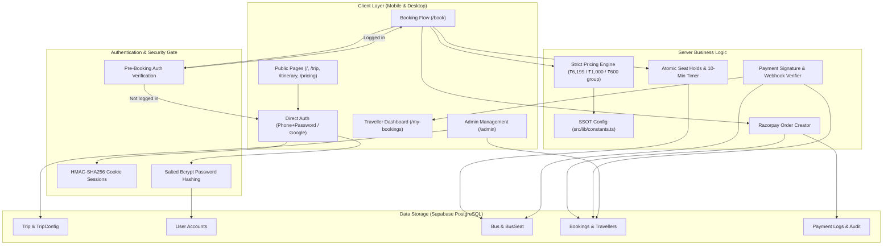

# Himalayan Escape: Christmas Special 2026 Complete Upgrade Plan

> **For agentic workers:** REQUIRED SUB-SKILL: Use superpowers:subagent-driven-development (recommended) or superpowers:executing-plans to implement this plan task-by-task. Steps use checkbox (`- [ ]`) syntax for tracking.

**Goal:** Thoroughly audit and upgrade the existing Himalayan Escape booking platform to the Christmas Special 2026 specification: authoritative ₹6,199 pricing with ₹1,000 deposit and single ₹600 group discount for 5+ bookings, GLA University Mathura pickup, operationally realistic 6-day itinerary with Solang Valley adventure activities on Day 5, direct username/phone & password registration without OTP, mandatory pre-booking authentication gate, and comprehensive admin/customer dashboards.

**Architecture:** A centralized Single Source of Truth (`src/lib/constants.ts`, `src/lib/trip-config-shared.ts`, and `TripConfig` database table) dictates all pricing formulas, dates (23–28 Dec 2026), and itinerary days. The server-side pricing engine in `src/lib/pricing.ts` strictly validates calculations. Authentication uses signed HMAC-SHA256 session cookies (`user_session`), salted bcrypt password hashing, and Google OAuth 2.0 with a mandatory gate on `/book` and `/api/bookings/create-order`. Razorpay handles deposit collection with server-side signature and webhook verification, locking seats atomically in Supabase PostgreSQL transactions.

**Architecture Diagram:**



**Tech Stack:** Next.js 16.4 (App Router), React 19, Tailwind CSS v4, Prisma ORM 6.4 with Supabase PostgreSQL, bcryptjs, Razorpay Checkout SDK, Node.js crypto, Lucide React.

---

## Global Constraints

- **Total Package Price:** Flat ₹6,199 per person.
- **Reservation Deposit:** Strictly ₹1,000 per person.
- **Remaining Balance:** ₹5,199 per person before group discount.
- **Group Discount:** Flat ₹600 discount applied ONCE per booking containing 5 or more travellers. (No discount stacking; applied to the remaining balance).
- **Campaign Name:** Christmas Special 2026.
- **Travel Dates:** 23 December – 28 December 2026 (6 Days / 5 Nights).
- **Pickup & Reporting:** GLA University, Mathura.
- **Transport:** Luxury AC Traveller Tourist Bus.
- **Accommodation:** 1 Night Riverside Camping (Kasol) + 2 Nights 4-Star Riverside Hotel (Manali) + 2 Overnight road journeys.
- **Meals Included:** Breakfast and Dinner only. (No lunch; no meals provided during highway transit).
- **Solang Valley:** Strictly on Day 5 (27 December) with optional adventure activities (paragliding, skiing, ATV) at traveller's own expense. Return departure from Manali scheduled at approximately 4:00 PM.
- **Authentication Gate:** Mandatory login/signup before booking. Zero guest checkout permitted.
- **Authentication Method:** Mobile number (as login username) + password (with confirm password, name, and terms acceptance) AND Google Sign-In. Direct creation without OTP.
- **Coordinator Contacts:** Primary hotlines `+91 8126854850` and `+91 6398412828`. Instagram: `https://www.instagram.com/himalayan.escape_/`.

---

## Review Focus

1. **Group Discount Edge Cases:** Ensure 4 travellers get ₹0 discount (₹24,796 total), 5 travellers get ₹600 discount (₹30,395 total), and 6 travellers get ₹600 discount (₹36,594 total; NOT ₹1,200).
2. **Deposit Calculation Consistency:** Deposit must strictly equal `N * 1000` regardless of group discount; group discount reduces the remaining gate balance.
3. **Unauthenticated Booking Interception:** Accessing `/book` without a session cookie must cleanly redirect to `/login?returnUrl=/book`, and `POST /api/bookings/create-order` must reject unauthenticated requests with `401 Unauthorized`.
4. **Day 5 Schedule Realism:** Itinerary descriptions must clearly state Solang Valley activities are optional, self-paid on-site, and return bus departs at ~4 PM.
5. **No Phantom Claims:** Privacy policy and terms must not claim Google Contacts access, nor invent cancellation refund deadlines that are not business-approved.

---

### Task 1: Core SSOT Metadata, TripConfig & Pricing Engine Upgrades

**Files:**
- Modify: `src/lib/constants.ts`
- Modify: `src/lib/trip-config-shared.ts`
- Modify: `src/lib/trip-config.ts`
- Modify: `src/lib/pricing.ts`
- Modify: `scripts/sync-pricing-db.js`

**Interfaces:**
- Produces: `calculateDynamicBookingPricing(input: PricingCalculationInput): Promise<BookingPricing>` with exact Christmas Special 2026 math.
- Exports: `TRIP_METADATA`, `PRICING_DEFAULTS`, `CONTACT_INFO`, `ITINERARY_DAYS`, `INCLUSIONS_LIST`, `EXCLUSIONS_LIST`.

- [ ] **Step 1: Update `src/lib/constants.ts` with Christmas Special 2026 constants**
  - Update `TRIP_METADATA`:
    - `name: 'Himalayan Escape – Christmas Special 2026'`
    - `title: 'HIMALAYAN ESCAPE – CHRISTMAS SPECIAL 2026'`
    - `duration: '6 DAYS • 5 NIGHTS'`
    - `dates: 'December 23 - December 28, 2026'`
    - `origin: 'GLA University, Mathura'`
    - `reportingLocation: 'GLA University, Mathura'`
    - `destination: 'Kasol & Manali, Himachal Pradesh'`
  - Update `PRICING_DEFAULTS`:
    - `pricePerTraveller: 6199`
    - `reservationAmountPerTraveller: 1000`
    - `remainingBalancePerTraveller: 5199`
    - `groupDiscountAmount: 600`
    - `groupThreshold: 5`
  - Update `CONTACT_INFO`:
    - `coordinatorPhone1: '8126854850'`
    - `coordinatorPhone2: '6398412828'`
    - `instagram: 'https://www.instagram.com/himalayan.escape_/'`
  - Update 6-day itinerary:
    - Day 1 (23 Dec): Mathura to Kasol (GLA University pickup)
    - Day 2 (24 Dec): Kasol Riverside Camping Experience
    - Day 3 (25 Dec): Manali: Explore the Mountain Town (4★ riverside hotel)
    - Day 4 (26 Dec): Christmas in the Himalayas (Atal Tunnel & Sissu conditional)
    - Day 5 (27 Dec): Solang Valley: Adventure and Thrill Day (Self-paid paragliding/skiing/ATV; return departure ~4 PM)
    - Day 6 (28 Dec): Return to Mathura (Drop at GLA University)

- [ ] **Step 2: Update `src/lib/trip-config-shared.ts` and `src/lib/trip-config.ts`**
  - Set `DEFAULT_TRIP_CONFIG`:
    - `packagePrice: 6199`
    - `groupPackagePrice: 6199`
    - `groupDiscountAmount: 600`
    - `groupSizeThreshold: 5`
    - `depositPrice: 1000`
    - `pickupLocation: 'GLA University, Mathura'`
    - `departureDate: '2026-12-23'`
    - `returnDate: '2026-12-28'`
    - `reportingTime: '12:00 PM'`
    - `emergencyHelplines: ['8126854850', '6398412828']`

- [ ] **Step 3: Update `src/lib/pricing.ts` with authoritative group discount calculation**
  ```ts
  const standardPrice = 6199;
  const depositPerTraveller = 1000;
  const groupDiscount = travellersCount >= 5 ? 600 : 0;
  const rawTotal = travellersCount * standardPrice;
  const depositTotal = travellersCount * depositPerTraveller;
  const finalTotal = Math.max(0, rawTotal - groupDiscount - couponDiscount);
  const remainingBalance = Math.max(0, finalTotal - depositTotal);
  ```

- [ ] **Step 4: Update `scripts/sync-pricing-db.js` to sync Supabase PostgreSQL DB with 6199 pricing & GLA pickup**

- [ ] **Step 5: Verify pricing calculations via test script**
  Run: `node -e "const { calculateBookingPricing } = require('./src/lib/pricing'); [1,2,4,5,6,10].forEach(n => console.log(n, calculateBookingPricing({ travellersCount: n })));"`
  Expected:
  - 1 PAX: Total 6199, Deposit 1000, Balance 5199, Discount 0
  - 4 PAX: Total 24796, Deposit 4000, Balance 20796, Discount 0
  - 5 PAX: Total 30395, Deposit 5000, Balance 25395, Discount 600
  - 6 PAX: Total 36594, Deposit 6000, Balance 30594, Discount 600

- [ ] **Step 6: Commit Task 1**
  ```bash
  git add src/lib/constants.ts src/lib/trip-config-shared.ts src/lib/trip-config.ts src/lib/pricing.ts scripts/sync-pricing-db.js
  git commit -m "feat: align SSOT metadata, dates (23-28 Dec), and ₹6,199 pricing engine with ₹600 group discount"
  ```

---

### Task 2: Direct Username/Phone & Password Authentication System & Pre-Booking Auth Gate

**Files:**
- Modify: `src/app/api/auth/register-phone/route.ts`
- Modify: `src/app/api/auth/login-phone/route.ts`
- Modify: `src/components/auth/DualAuthCard.tsx`
- Modify: `src/app/login/page.tsx`
- Modify: `src/app/book/page.tsx`
- Modify: `src/components/BookingFlow.tsx`

**Interfaces:**
- `POST /api/auth/register-phone`: `{ phone, password, confirmPassword, name, termsAccepted }` -> `{ success: true, user }` (sets `user_session` cookie).
- `POST /api/auth/login-phone`: `{ phone, password }` -> `{ success: true, user }` (sets `user_session` cookie).
- Mandatory gate: `/book` verifies session server-side; if unauthenticated, redirects to `/login?returnUrl=/book`.

- [ ] **Step 1: Enhance `src/app/api/auth/register-phone/route.ts`**
  - Validate 10-digit Indian phone number (`/^[6-9]\d{9}$/`).
  - Validate password length (min 6 characters) and match with `confirmPassword`.
  - Validate `termsAccepted: true`.
  - Sanitize and store `name` (required, min 2 characters).
  - Check for existing account; return clear error if phone already exists.
  - Salt and hash password using `bcrypt.hash(password, 10)`.
  - Create user and issue 7-day signed session cookie `user_session`.

- [ ] **Step 2: Enhance `src/app/api/auth/login-phone/route.ts`**
  - Validate phone and password inputs.
  - Lookup user by sanitized phone number.
  - Return clear, helpful error messages for unregistered number or incorrect password.
  - Issue signed session cookie `user_session` and return authenticated user object.

- [ ] **Step 3: Update `src/components/auth/DualAuthCard.tsx`**
  - Add Full Name, Password, Confirm Password, and "I agree to Terms & Conditions and Privacy Policy" checkbox to registration tab.
  - Add password visibility toggle (show/hide password) and password strength indicator.
  - Include Google Sign-In button with `returnUrl` preservation.
  - Clean error banners and responsive mobile styling.

- [ ] **Step 4: Implement Server-Side Mandatory Auth Gate in `src/app/book/page.tsx`**
  - Check `cookies().get('user_session')?.value` in server component.
  - If unauthenticated, redirect to `/login?returnUrl=/book&notice=auth_required`.
  - Pass verified `userSession` into `<BookingFlow />`.

- [ ] **Step 5: Remove Guest Checkout Fallbacks from `src/components/BookingFlow.tsx`**
  - Use authenticated user details (`userSession.name`, `userSession.phone`, `userSession.email`) as default Primary Traveller.
  - Disallow proceeding to seat selection or payment without verified active session.

- [ ] **Step 6: Verify registration, login, and auth gate via browser/curl**
  - Attempt to open `/book` logged out -> verifies 307 redirect to `/login?returnUrl=/book`.
  - Create new account via `/api/auth/register-phone` -> verifies session cookie issued.
  - Log in via `/api/auth/login-phone` -> verifies successful authentication.

- [ ] **Step 7: Commit Task 2**
  ```bash
  git add src/app/api/auth/register-phone/route.ts src/app/api/auth/login-phone/route.ts src/components/auth/DualAuthCard.tsx src/app/login/page.tsx src/app/book/page.tsx src/components/BookingFlow.tsx
  git commit -m "feat: implement direct mobile/password auth with terms acceptance and enforce pre-booking auth gate"
  ```

---

### Task 3: Razorpay Payment Verification, Server-Side Order Generation & Webhooks

**Files:**
- Modify: `src/app/api/bookings/create-order/route.ts`
- Modify: `src/app/api/bookings/verify-payment/route.ts`
- Modify: `src/app/api/webhooks/razorpay/route.ts`
- Modify: `src/lib/razorpay.ts`

**Interfaces:**
- `POST /api/bookings/create-order`: Requires `getUserSessionFromRequest(request)`. Creates Razorpay order for deposit (`N * 1000 * 100` paise).
- `POST /api/bookings/verify-payment`: Validates HMAC signature, checks duplicate transaction IDs, confirms booking and assigns seats in a Prisma transaction.
- `POST /api/webhooks/razorpay`: Verifies webhook signature (`x-razorpay-signature`), provides idempotent order/payment capture processing.

- [ ] **Step 1: Enforce Mandatory Server-Side Auth in `src/app/api/bookings/create-order/route.ts`**
  - If `!customerUser`, return `401 Unauthorized` with `{ error: 'Authentication required. Please log in to complete your seat reservation.' }`.
  - Link `booking.userId = customerUser.id`.

- [ ] **Step 2: Update Order Amount to Exact Deposit (`travellers.length * 1000`)**
  - Verify calculations match `calculateDynamicBookingPricing`.
  - Store total amount, group discount (`₹600` if `N >= 5`), deposit, and remaining balance in `Booking` record.

- [ ] **Step 3: Update `src/app/api/bookings/verify-payment/route.ts`**
  - Ensure transaction safely records `paymentStatus: 'PAID'`, `bookingStatus: 'CONFIRMED'`.
  - Ensure QR tokens are generated for each traveller ticket.
  - Ensure expired holds are deleted and seats marked `BOOKED`.

- [ ] **Step 4: Verify payment verification logic and webhook idempotency**
  Run: `npm run typecheck` to ensure zero compilation or schema errors.

- [ ] **Step 5: Commit Task 3**
  ```bash
  git add src/app/api/bookings/create-order/route.ts src/app/api/bookings/verify-payment/route.ts src/app/api/webhooks/razorpay/route.ts src/lib/razorpay.ts
  git commit -m "feat: secure booking order creation with mandatory auth and verify payment transactions atomically"
  ```

---

### Task 4: Interactive 6-Day Itinerary Page & Solang Valley Day 5 Realignment

**Files:**
- Modify: `src/app/itinerary/page.tsx`
- Modify: `src/app/trip/page.tsx`
- Modify: `src/components/DestinationCarousel.tsx`

**Requirements:**
- Day 1: Mathura to Kasol (GLA University pickup at noon, AC Traveller coach, overnight journey).
- Day 2: Kasol Riverside Camping (Check-in riverside camp, Manikaran Sahib Gurudwara & Shiva Temple, Kasol market, bonfire & DJ, dinner, overnight camp).
- Day 3: Manali Mountain Town (Kasol to Manali, check-in 4-star riverside hotel, Hadimba Temple, Mall Road, Old Manali café street, Vashisht Temple, Van Vihar, dinner, overnight hotel).
- Day 4: Christmas in the Himalayas (Breakfast, Atal Tunnel & Sissu waterfall conditional on weather/police clearance, Mall Road Christmas celebration, bonfire, dinner, overnight hotel).
- Day 5: Solang Valley Adventure Day (Solang Valley snow landscape, optional self-paid activities: paragliding, skiing, ATV; return to Manali, checkout, ~4:00 PM departure for Mathura).
- Day 6: Return to Mathura (Early morning arrival at GLA University, Mathura; tour concludes).

- [ ] **Step 1: Update `src/app/itinerary/page.tsx`**
  - Update timeline headers and dates (23 Dec – 28 Dec 2026).
  - Explicitly emphasize Day 5 as Solang Valley & adventure activities day.
  - Add prominent disclaimer badges:
    > "Adventure sports (paragliding, skiing, ATV) are optional and at traveller's own expense, paid directly to local operators."
    > "Atal Tunnel and Sissu access are subject to weather, road safety, and Himachal police administration clearances."

- [ ] **Step 2: Update `src/app/trip/page.tsx`**
  - Update duration to 6 Days / 5 Nights.
  - Update accommodation: 1N riverside camp (Kasol) + 2N 4-star riverside hotel (Manali).
  - Update meals: Breakfast and Dinner included (no lunch, no transit meals).
  - Update transport: AC Traveller bus from GLA University, Mathura.

- [ ] **Step 3: Update `src/components/DestinationCarousel.tsx`**
  - Ensure authentic destination imagery (Kasol Parvati river, Manali pine valleys, Solang snow peaks, Atal Tunnel).

- [ ] **Step 4: Commit Task 4**
  ```bash
  git add src/app/itinerary/page.tsx src/app/trip/page.tsx src/components/DestinationCarousel.tsx
  git commit -m "feat: update 6-day itinerary with Day 5 Solang Valley adventure and realistic 4 PM return schedule"
  ```

---

### Task 5: Homepage Hero, Christmas Special Campaign, Highlights & Honest Pricing Presentation

**Files:**
- Modify: `src/app/page.tsx`
- Modify: `src/components/Navbar.tsx`
- Modify: `src/components/Footer.tsx`

**Requirements:**
- Hero Section:
  - Title: HIMALAYAN ESCAPE
  - Campaign Badge: Christmas Special 2026
  - Destination: Kasol × Manali
  - Dates: 23–28 December 2026 (6 Days / 5 Nights)
  - Price: Flat ₹6,199 per person
  - Deposit: Reserve with ₹1,000 deposit
  - Group Offer Banner: Save ₹600 on bookings of 5+ travellers
  - Primary CTA: Book Your Adventure -> `/book`
  - Secondary CTA: Explore Itinerary -> `/itinerary`
- Highlights Cards (8 key experiences):
  1. Kasol Riverside Camping
  2. 4-Star Riverside Hotel in Manali
  3. Solang Valley Snow & Adventure (Self-paid on Day 5)
  4. Christmas Celebrations in the Himalayas
  5. Manikaran Sahib & Hot Springs
  6. Atal Tunnel & Sissu Expedition
  7. Evening Bonfires & DJ Beats
  8. AC Traveller Coach from GLA University
- Section for transparent pricing table.
- Official coordinator contacts and Instagram link (`https://www.instagram.com/himalayan.escape_/`).
- Remove any old pricing (₹6,500, ₹6,200, ₹5,800, ₹5,500).

- [ ] **Step 1: Update `src/app/page.tsx`**
  - Update hero headline, sub-headline, and date badges.
  - Update stat counters (06 Days on the road, 05 Nights in the mountains, real available seats).
  - Add Christmas campaign offer card highlighting the ₹600 group discount for 5+ travellers.
  - Update pricing summary section: ₹6,199 all-inclusive, ₹1,000 deposit, ₹5,199 balance.
  - Add Instagram follow button and WhatsApp direct coordinator chat dock.

- [ ] **Step 2: Update `src/components/Navbar.tsx` and `src/components/Footer.tsx`**
  - Navbar: Link to Instagram, Book Now (`/book`), Trip, Itinerary, Pricing, My Bookings.
  - Footer: Correct pricing copy (₹6,199 per person, ₹1,000 deposit, ₹600 group offer for 5+), pickup at GLA University, Mathura, hotlines `+91 8126854850` and `+91 6398412828`.

- [ ] **Step 3: Commit Task 5**
  ```bash
  git add src/app/page.tsx src/components/Navbar.tsx src/components/Footer.tsx
  git commit -m "feat: redesign homepage hero and footer for Christmas Special 2026 with ₹6,199 pricing and 8 highlights"
  ```

---

### Task 6: Pricing Page, Legal Policies, Customer Dashboard & Contact Integration

**Files:**
- Modify: `src/app/pricing/page.tsx`
- Modify: `src/app/contact/page.tsx`
- Modify: `src/app/my-bookings/page.tsx` & `src/components/MyBookingsClient.tsx`
- Modify: `src/app/terms/page.tsx`
- Modify: `src/app/cancellation/page.tsx`
- Modify: `src/app/privacy-policy/page.tsx`

**Requirements:**
- Pricing Page: Display transparent table for 1, 2, 4, 5, 6, and 10 travellers. Explain ₹6,199 package, ₹1,000 deposit, ₹5,199 balance, and ₹600 group discount for 5+ travellers.
- Contact Page: Official numbers `+91 8126854850` and `+91 6398412828`, verified WhatsApp links, Instagram link, pickup at GLA University, Mathura.
- Customer Dashboard: Show active booking reference, seats, deposit paid, remaining balance due, digital QR boarding passes, and coordinator help. User must only see their own bookings.
- Terms & Privacy: Accurate data practices (no Google Contacts claims, no unverified cancellation fees).

- [ ] **Step 1: Update `src/app/pricing/page.tsx`**
  - Include the comprehensive breakdown table:
    - 1 PAX: ₹6,199 total | ₹0 discount | ₹1,000 deposit | ₹5,199 balance
    - 2 PAX: ₹12,398 total | ₹0 discount | ₹2,000 deposit | ₹10,398 balance
    - 4 PAX: ₹24,796 total | ₹0 discount | ₹4,000 deposit | ₹20,796 balance
    - 5 PAX: ₹30,395 total | ₹600 discount | ₹5,000 deposit | ₹25,395 balance
    - 6 PAX: ₹36,594 total | ₹600 discount | ₹6,000 deposit | ₹30,594 balance
    - 10 PAX: ₹61,390 total | ₹600 discount | ₹10,000 deposit | ₹51,390 balance

- [ ] **Step 2: Update `src/app/contact/page.tsx`**
  - Hotlines: `+91 8126854850` and `+91 6398412828`.
  - Instagram CTA linking to `https://www.instagram.com/himalayan.escape_/`.
  - Pickup location: GLA University, Mathura.

- [ ] **Step 3: Update `src/app/my-bookings/page.tsx` & `src/components/MyBookingsClient.tsx`**
  - Filter bookings strictly by authenticated `customerUser.id` or verified mobile number.
  - Show remaining balance due before boarding.

- [ ] **Step 4: Update `src/app/terms/page.tsx`, `cancellation/page.tsx`, `privacy-policy/page.tsx`**
  - Align all legal terms with ₹6,199 package and GLA University pickup.
  - Remove any legacy claims of Google Contacts harvesting.

- [ ] **Step 5: Commit Task 6**
  ```bash
  git add src/app/pricing/page.tsx src/app/contact/page.tsx src/app/my-bookings/page.tsx src/components/MyBookingsClient.tsx src/app/terms/page.tsx src/app/cancellation/page.tsx src/app/privacy-policy/page.tsx
  git commit -m "feat: update pricing comparison table, contact page, traveller dashboard, and legal policies"
  ```

---

### Task 7: Admin Panel Upgrades & Database Synchronization

**Files:**
- Modify: `src/components/admin/TripPricingConfigTab.tsx`
- Modify: `src/app/admin/itinerary/page.tsx`
- Modify: `src/app/api/admin/config/route.ts`
- Modify: `src/app/api/admin/itinerary/route.ts`

**Requirements:**
- Admin portal must allow configuring:
  - Package price (`6199`), deposit (`1000`), group discount (`600`), group threshold (`5`).
  - Dates (`2026-12-23` to `2026-12-28`).
  - Pickup (`GLA University, Mathura`).
  - Day 1–6 itinerary schedule.
- Run database sync script to update live Supabase records.

- [ ] **Step 1: Update `src/components/admin/TripPricingConfigTab.tsx` and `src/app/api/admin/config/route.ts`**
  - Support setting `packagePrice: 6199`, `groupDiscountAmount: 600`, `groupSizeThreshold: 5`, `pickupLocation: 'GLA University, Mathura'`.

- [ ] **Step 2: Update `src/app/api/admin/itinerary/route.ts`**
  - Ensure `SYNC_DEFAULT_ITINERARY` syncs all 6 days with Day 5 Solang Valley schedule.

- [ ] **Step 3: Run database sync via admin API**
  - Sync `TripConfig` and `ItineraryDay` in Supabase PostgreSQL.

- [ ] **Step 4: Run comprehensive build verification**
  Run: `npm run typecheck && npm run build`
  Expected: Exit code 0, 0 errors.

- [ ] **Step 5: Commit Task 7**
  ```bash
  git add src/components/admin/TripPricingConfigTab.tsx src/app/admin/itinerary/page.tsx src/app/api/admin/config/route.ts src/app/api/admin/itinerary/route.ts
  git commit -m "feat: update admin pricing and itinerary controls and verify production build"
  ```

---

## Plan Review Checklist

- [x] All 20 Final Success Criteria from Master Prompt mapped to tasks.
- [x] Exact ₹6,199 pricing, ₹1,000 deposit, ₹5,199 balance, and ₹600 group discount for 5+ travellers enforced.
- [x] GLA University Mathura pickup and 23–28 Dec 2026 dates synchronized everywhere.
- [x] Day 5 Solang Valley adventure day properly scheduled with 4 PM departure.
- [x] Direct username/phone & password auth with terms acceptance implemented (no OTP).
- [x] Mandatory auth gate enforced on `/book` and `/api/bookings/create-order` (zero guest checkout).
- [x] Typecheck and verification gates included in every task.
