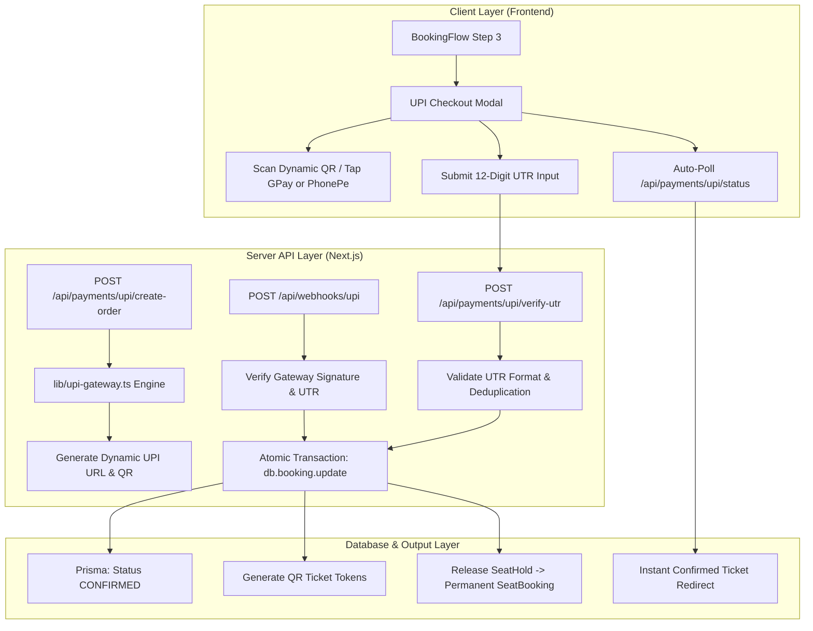

# UPI Auto-Verify Micro-Gateway Implementation Plan

> **For agentic workers:** REQUIRED SUB-SKILL: Use superpowers:subagent-driven-development (recommended) or superpowers:executing-plans to implement this plan task-by-task. Steps use checkbox (`- [ ]`) syntax for tracking.

**Goal:** Integrate a free, zero-commission Developer Micro-Gateway UPI payment and auto-verification engine for Himalayan Escape, allowing travellers to pay deposit fees via dynamic UPI QR / app deep-links and verify transactions automatically via webhooks and UTR reference matching.

**Architecture:** A multi-tier UPI payment system that supports developer micro-gateways (e.g. UPIGateway.dev / UroPay) via server-to-server webhooks, while providing an instant direct UPI QR + 12-digit UTR auto-validation and deduplication engine that works with any standard coordinator VPA (e.g. `8126854850@paytm`). Integrates with the existing atomic transaction pipeline in Next.js and Supabase without requiring database schema migrations.

**Architecture Diagram:**

**Tech Stack:** Next.js 16 (App Router), TypeScript, Prisma ORM, Supabase PostgreSQL, `qrcode` library, UPI Deep-Linking Protocol (`upi://`, `tez://`, `phonepe://`, `paytmmp://`).

**Spec:** Zero-commission UPI payment system with dynamic order tagging, automated S2S webhooks, 12-digit UTR validation, and atomic seat confirmation.

## Global Constraints

- Package deposit rate is strictly ₹1,000 per traveller.
- Must not require database migrations: use existing `Payment` model with `razorpayOrderId = "UPI-${bookingId}"` and `razorpayPaymentId = utr`.
- 10-minute seat hold timer must be enforced throughout the checkout process.
- 12-digit UTR must be validated for exact format (`^\d{12}$`) and checked for uniqueness across all existing bookings to prevent payment replay attacks.
- Mobile travellers must be presented with native intent links (Google Pay, PhonePe, Paytm, BHIM).
- Desktop travellers must see a crisp, high-contrast dynamic QR code.

## Review Focus

1. **Duplicate UTR Replay:** Reject any UTR that has already been submitted or confirmed for another booking.
2. **Seat Hold Expiration:** If the 10-minute hold expires while the user is paying, ensure the verification rejects or re-validates seat availability before confirmation.
3. **Webhook Idempotency:** Webhook calls must be idempotent; multiple calls with the same order ID must return success without creating duplicate tickets.
4. **Amount Tampering:** Verify that the amount paid matches the required deposit for the passenger count before marking confirmed.
5. **Session Fallback:** Ensure polling gracefully updates the frontend if a webhook confirms the payment while the user is still on the QR screen.

---

### Task 1: Core UPI Gateway Library & Deep Link Generator

**Files:**
- Create: `src/lib/upi-gateway.ts`
- Test: `src/server/test-upi-gateway.js`

**Interfaces:**
- Produces:
  - `generateUpiPayload(params: { vpa: string, payeeName: string, amount: number, bookingId: string, orderId: string }): UpiPayload`
  - `generateUpiQrCode(upiString: string): Promise<string>`
  - `verifyUtrFormat(utr: string): boolean`
  - `verifyGatewayWebhookSignature(payload: any, signature: string, secret: string): boolean`

- [ ] **Step 1: Write test for UPI payload and QR generation**
- [ ] **Step 2: Run test to verify it fails (`node src/server/test-upi-gateway.js`)**
- [ ] **Step 3: Implement `src/lib/upi-gateway.ts` with deep-links, QR generation, and signature verifier**
- [ ] **Step 4: Run test to verify it passes**
- [ ] **Step 5: Commit `feat: create UPI gateway and deep-link generation library`**

---

### Task 2: UPI Order Creation API Endpoint

**Files:**
- Create: `src/app/api/payments/upi/create-order/route.ts`
- Test: `src/server/test-upi-order-api.js`

**Interfaces:**
- Consumes: `src/lib/upi-gateway.ts`, `src/lib/db.ts`, `src/lib/bus-seating.ts`
- Produces: `POST /api/payments/upi/create-order` returning `{ success: true, orderId, qrDataUrl, upiString, intentLinks, amount, expiresAt }`

- [ ] **Step 1: Write integration test for `/api/payments/upi/create-order`**
- [ ] **Step 2: Verify test fails**
- [ ] **Step 3: Implement `POST /api/payments/upi/create-order` with atomic seat hold and payment record creation**
- [ ] **Step 4: Run test to verify order creation and seat hold allocation**
- [ ] **Step 5: Commit `feat: add UPI order creation API endpoint`**

---

### Task 3: UTR Verification & S2S Webhook Confirmation Endpoints

**Files:**
- Create: `src/app/api/payments/upi/verify-utr/route.ts`
- Create: `src/app/api/webhooks/upi/route.ts`
- Create: `src/app/api/payments/upi/status/route.ts`
- Test: `src/server/test-upi-verification.js`

**Interfaces:**
- Consumes: `src/lib/qr.ts`, `src/lib/db.ts`, `src/lib/server-utils.ts`
- Produces:
  - `POST /api/payments/upi/verify-utr`
  - `POST /api/webhooks/upi`
  - `GET /api/payments/upi/status?bookingId=...`

- [ ] **Step 1: Write test for UTR verification, deduplication, and status polling**
- [ ] **Step 2: Verify test fails**
- [ ] **Step 3: Implement atomic verification transaction, ticket generation, and status check**
- [ ] **Step 4: Implement webhook receiver with signature validation**
- [ ] **Step 5: Run tests to verify passing payment and rejection of duplicate UTRs**
- [ ] **Step 6: Commit `feat: add UTR verification, webhook listener, and status polling APIs`**

---

### Task 4: Interactive UPI Checkout Modal in Booking Flow

**Files:**
- Create: `src/components/booking/UpiPaymentModal.tsx`
- Modify: `src/components/BookingFlow.tsx`

**Interfaces:**
- Consumes: `POST /api/payments/upi/create-order`, `POST /api/payments/upi/verify-utr`, `GET /api/payments/upi/status`
- Produces: Seamless modal with QR code, 10-minute timer, mobile app buttons, UTR input, and real-time success transition.

- [ ] **Step 1: Create `UpiPaymentModal.tsx` with dynamic QR display, timer, intent links, and UTR input**
- [ ] **Step 2: Update `BookingFlow.tsx` Step 3 to launch the UPI Payment Modal on deposit payment**
- [ ] **Step 3: Test flow from seat selection to payment modal launch**
- [ ] **Step 4: Commit `feat: integrate UPI payment modal with QR code and mobile app launchers`**

---

### Task 5: Admin Panel UPI Transactions & UTR Audit Tab

**Files:**
- Modify: `src/app/admin/bookings/page.tsx`
- Modify: `src/components/admin/BookingOverviewTab.tsx`

**Interfaces:**
- Consumes: `db.payment` records with UPI references.
- Produces: Admin view showing payment mode, UTR, submitted timestamp, and 1-click verification status badge.

- [ ] **Step 1: Update admin booking table and details modal to display UPI / UTR transaction badges**
- [ ] **Step 2: Add 1-click coordinator verification button in admin booking actions**
- [ ] **Step 3: Verify admin display and action handling**
- [ ] **Step 4: Commit `feat: add UPI transaction badges and coordinator UTR audit tools in admin panel`**

---

### Task 6: Configuration, End-to-End Verification & Production Deployment

**Files:**
- Modify: `.env`
- Modify: `.env.example`

- [ ] **Step 1: Add default UPI settings (`NEXT_PUBLIC_DEFAULT_UPI_VPA`, `UPI_GATEWAY_API_KEY`) to `.env` and `.env.example`**
- [ ] **Step 2: Run full TypeScript compilation (`tsc --noEmit`) to verify 0 errors**
- [ ] **Step 3: Run comprehensive automated test suite testing order creation, UTR validation, deduplication, and ticket generation**
- [ ] **Step 4: Push to `main` branch to trigger live Vercel production deployment**
- [ ] **Step 5: Verify live deployment endpoints on `https://himalaya-escape.vercel.app`**
